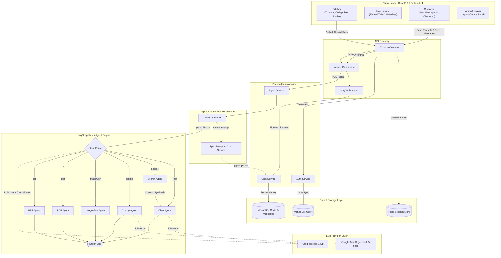

# Nexus Node ⚡

> **An event-driven, distributed multi-agent AI workspace designed for intelligent task orchestration and collaborative conversational workflows.**

[](https://nodejs.org)
[](https://expressjs.com/)
[](https://react.dev/)
[](https://tailwindcss.com/)
[](https://www.langchain.com/langgraph)
[](https://groq.com/)
[](https://ai.google.dev/)
[](https://redis.io/)
[](https://www.mongodb.com/)
[](https://firebase.google.com/)
[](LICENSE)

---

## 📌 Overview

**Nexus Node** is a scalable, microservices-based AI platform that routes user inquiries to dedicated, specialized AI agents using a dynamic graph routing engine. Rather than relying on a single monolithic language model, Nexus Node distributes domain-specific tasks (general conversation, code synthesis, visual generation, document analysis, presentation building, and web search) across isolated agent nodes powered by tailored LLM providers (Groq and Google Gemini).

The system is decoupled into an **API Gateway**, independent **Domain Microservices**, a **LangGraph Multi-Agent Engine**, and a reactive **Vite + React 19 Frontend**.

---

## 🏗️ System Architecture



---

## 🧩 Current Implementation Status

Here is an exact, deep-dive summary of what is built and operating today versus what is being actively expanded:

### 1. Ingress & API Gateway (`/backend/gateway`)
- [x] **Reverse Proxy Integration**: Uses `express-http-proxy` to route requests transparently to respective microservices.
- [x] **Session Guard Middleware (`protect`)**: Verifies HTTP-only session cookies against Redis in real time before admitting requests to protected routes.
- [x] **Header Injection (`proxyWithHeader`)**: Extracts user credentials from Redis and automatically injects metadata (`x-user-id`) into downstream service requests.
- [x] **CORS & Cookie Parser**: Centralized cookie management and origin validation.
- [x] **Request Logging (`morgan`)**: Configured with `'dev'` format for live endpoint traffic observability and diagnostics.

### 2. Auth Service (`/backend/services/auth`)
- [x] **Firebase Authentication Integration**: Validates Google OAuth ID tokens on the server using `firebase-admin`.
- [x] **User Sync & Persistence**: Automatically provisions and syncs user records in MongoDB upon successful token verification.
- [x] **Redis-Backed Session Management**: Issues UUIDv4 session identifiers stored in Redis with 7-day TTL and dispatches `httpOnly`, `sameSite: strict` cookies.
- [x] **Logout Invalidation**: Destroys session keys in Redis and clears browser cookies.

### 3. Chat Service (`/backend/services/chat`)
- [x] **Thread Management**: Endpoints to create (`/create-conversation`), update titles (`/update-conversation`), and query conversation lists (`/get-conversation`).
- [x] **Message Persistence**: Schema for role-based (`user`/`assistant`) message logs mapped to `conversationId` (`/save-message`).
- [x] **Message Retrieval**: Route `/get-messages/:conversationId` providing complete conversation message history sorted by creation timestamps.

### 4. Agent Service (`/backend/services/agent`)
- [x] **Multi-LLM Provider Engine (`config/llmModels.js`)**: Dynamic provider factory (`getModel`) supplying:
  - **Groq (`openai/gpt-oss-120b`)**: High-speed inference for semantic routing, general conversation, and research synthesis.
  - **Google Gemini (`gemini-2.5-flash`)**: High-capability multimodal model dedicated to code synthesis, debugging, and review.
- [x] **LLM Intent-Based Router (`graph/router.js`)**: Natural-language routing prompt that analyzes query semantics and directs tasks to the optimal domain agent with fallback safeguards.
- [x] **Agent State Management (`graph/state.js`)**: `agentState` root annotation maintaining conversational state across graph execution (`prompt`, `aiResponse`, `agent`, `conversationId`).
- [x] **Compiled StateGraph Pipeline (`graph/graph.js`)**:
  - Full StateGraph lifecycle configuration with conditional edges branching from the `router`.
  - Sequential agent chaining (`search` $\rightarrow$ `chat`) to synthesize search findings into clean conversational summaries.
  - Clean edge termination routing completed responses to `__end__`.
  - Compiled and exported graph pipeline via `workflow.compile()`.
- [x] **Agent Invocation Controller & API (`controllers/agent.contoller.js` & `routes/agent.route.js`)**:
  - `POST /chat` endpoint mounted on the agent service.
  - Inter-service persistence: automatically posts the incoming user prompt to `CHAT_SERVICE/save-message` before invoking the graph.
  - Invokes `graph.invoke({ prompt, conversationId })` and returns the generated `aiResponse`.
- [x] **Chat Agent Implementation (`agents/chat.agent.js`)**: Full dialogue agent with system persona instructions and prompt invocation against Groq.
- [ ] **Additional Domain Agents**: *Scaffolded & in progress* (`coding.agent.js`, `imageGen.agent.js`, `pdf.agent.js`, `ppt.agent.js`, `search.agent.js`).

### 5. Frontend Client (`/frontend`)
- [x] **Tri-Panel Workspace Layout (`pages/Home.jsx`)**: Responsive 3-column architecture featuring the collapsible `Sidebar`, primary `ChatArea`, and output `Artifact` viewer.
- [x] **Interactive & Collapsible Sidebar (`components/Sidebar.jsx`)**:
  - Real-time conversation thread fetching via `/api/chat/get-conversation`.
  - Active conversation thread selection with highlight styling.
  - "New Chat" creation triggering `/api/chat/create-conversation` with instant Redux state updates.
  - Expand/collapse toggle controls (`PanelLeftIcon` / `PanelRight`) with minimal collapsed view, shortcut actions, and bottom-anchored avatar.
- [x] **Chat Viewport Architecture (`components/ChatArea.jsx`)**:
  - `Nav.jsx`: Dynamic header with active conversation title (`selectedConv?.title || 'New Chat'`) and thread iconography.
  - `MessageList.jsx`: Message thread viewport container.
  - `ChatInput.jsx`: Conversation prompt input interface.
  - Auto-fetching messages via `features/getMessages.js` whenever `selectedConv` changes.
- [x] **User Profile & Session Controls**:
  - Google avatar rendering with graceful fallback icon on load error.
  - Subscription plan indicator ("Free Plan") and credit/coin balance shortcut.
  - Integrated logout button triggering backend `/api/auth/logout` and clearing client credentials.
- [x] **Redux Toolkit Global Store**:
  - `userSlice.js`: Authenticated user state and profile details.
  - `conversationSlice.js`: Conversation collection and active thread pointer (`selectedConv`).
  - `messageSlice.js`: Conversation message collection and updater (`setMessages`).
- [x] **Authentication Flow**: Firebase Google popup sign-in integrated with backend `/api/auth/login`.
- [ ] **Interactive Message Stream**: *In progress* (message bubble styling, markdown rendering, LLM dispatch, token streaming).

---

## 📂 Repository Structure

```text
nexus_node/
├── backend/
│   ├── docker-compose.yml         # Container configuration (Redis)
│   ├── gateway/                   # Ingress reverse proxy & auth middleware
│   │   ├── controllers/
│   │   ├── middleware/            # Redis-based session protector
│   │   ├── utils/                 # Header injection proxy utilities
│   │   └── index.js
│   ├── services/
│   │   ├── auth/                  # Authentication & Firebase Admin service
│   │   │   ├── config/            # Database & Firebase initialization
│   │   │   ├── controllers/
│   │   │   ├── model/             # User Mongoose model
│   │   │   └── routes/
│   │   ├── chat/                  # Conversation & message storage service
│   │   │   ├── config/
│   │   │   ├── controllers/
│   │   │   ├── models/            # Conversation & Message schemas
│   │   │   └── routes/
│   │   └── agent/                 # LangGraph multi-agent orchestration
│   │       ├── agents/            # Specialized agents (chat, coding, image, pdf, ppt, search)
│   │       ├── config/            # Database & Multi-LLM setup (Groq, Google Gemini)
│   │       ├── controllers/       # Chat synchronization & graph invocation
│   │       ├── graph/             # Dynamic router, state schema & compiled StateGraph
│   │       ├── routes/            # Agent service endpoints (/chat)
│   │       └── index.js
│   └── shared/
│       └── redis/                 # Shared ioredis client singleton
├── frontend/                      # Vite + React 19 Client
│   ├── src/
│   │   ├── components/            # Workspace views (Sidebar, ChatArea, Nav, MessageList, ChatInput, Artifact)
│   │   ├── features/              # Async actions (conversations, getMessages, logOut, getCurrentUser)
│   │   ├── pages/                 # Application views (Home)
│   │   ├── redux/                 # Redux slices (userSlice, conversationSlice, messageSlice) & store
│   │   └── utils/                 # Axios client instance & Firebase SDK init
│   └── package.json
└── README.md
```

---

## 🛠️ Tech Stack & Tools

| Domain | Technology | Description |
| :--- | :--- | :--- |
| **API Gateway** | Express 5, `express-http-proxy`, `morgan` | Ingress traffic routing, centralized auth guard, request logging & header mutation |
| **Agent Framework** | `@langchain/langgraph`, `@langchain/core` | State-driven multi-agent graph orchestration |
| **LLM Providers** | `@langchain/groq`, `@langchain/google-genai` | Multi-model integration (Groq `gpt-oss-120b` & Google Gemini `2.5-flash`) |
| **Cache & Sessions** | Redis, `ioredis` | Fast key-value session storage with automatic TTL |
| **Database** | MongoDB, Mongoose | Document database for users, conversation threads, and message logs |
| **Auth** | Firebase Auth (Client & Admin SDK) | Google identity provider verification and account synchronization |
| **Frontend** | React 19, Vite, Tailwind CSS v4 | High-performance reactive UI with modern styles |
| **State Management**| Redux Toolkit (`@reduxjs/toolkit`) | Predictable global client state container |
| **UI & Icons** | `lucide-react`, `react-icons` | Clean icon sets and responsive UI components |
| **Containers** | Docker Compose | Local Redis instance management |

---

## 🚀 Getting Started

### 1. Prerequisites
- [Node.js](https://nodejs.org/) (v18 or higher)
- [Docker Desktop](https://www.docker.com/) (for Redis)
- [MongoDB](https://www.mongodb.com/) (local instance or MongoDB Atlas)

---

### 2. Local Setup & Execution

1. **Start the Infrastructure (Redis)**:
   ```bash
   cd backend
   docker compose up -d
   ```

2. **Start the Backend Microservices**:
   Run each service in its respective directory:
   ```bash
   # Ingress API Gateway (Port 8000)
   cd backend/gateway && npm install && npm run dev

   # Authentication Service (Port 8001)
   cd backend/services/auth && npm install && npm run dev

   # Chat & Message Service (Port 8002)
   cd backend/services/chat && npm install && npm run dev

   # LangGraph Agent Service (Port 8003)
   cd backend/services/agent && npm install && npm run dev
   ```

3. **Start the Frontend Client**:
   ```bash
   cd frontend
   npm install
   npm run dev
   ```

Open `http://localhost:5173` in your browser to access the application workspace.

---

## 🗺️ Roadmap & Future Architecture

- [x] **LangGraph StateGraph & Routing**: Conditional edge routing architecture in `graph/graph.js` and state schema in `graph/state.js`.
- [x] **Multi-LLM Integration**: Dynamic provider engine in `config/llmModels.js` linking Groq (`gpt-oss-120b`) and Gemini (`gemini-2.5-flash`).
- [x] **Chat Agent & Conversation Persistence**: Automated inter-service message logging and live chat agent responses.
- [x] **Frontend Tri-Panel Workspace & Sidebar**: Integrated conversation threads, user profile footer, and session logout.
- [ ] **Chat Dialogue & Message Stream**: UI components (`Nav`, `MessageList`, `ChatInput`) and Redux store integration (`messageSlice`) scaffolded; active development on bubble styling, input submission, and token streaming in `ChatArea.jsx`.
- [ ] **Specialized Agents Execution**: Implement full execution pipelines for `coding.agent.js`, `imageGen.agent.js`, `pdf.agent.js`, `ppt.agent.js`, and `search.agent.js`.
- [ ] **Multi-Agent Memory**: Implement LangGraph checkpointers backed by Redis/MongoDB for cross-turn contextual memory.
- [ ] **Document & Vector Ingestion**: RAG pipeline for the `pdf.agent.js` and `search.agent.js` using vector embeddings.
- [ ] **Artifact Viewer Integration**: Live rendering of code snippets, diagrams, and media in `Artifact.jsx`.

---

## 📄 License

This project is licensed under the Apache License 2.0. See the [LICENSE](LICENSE) file for details.
